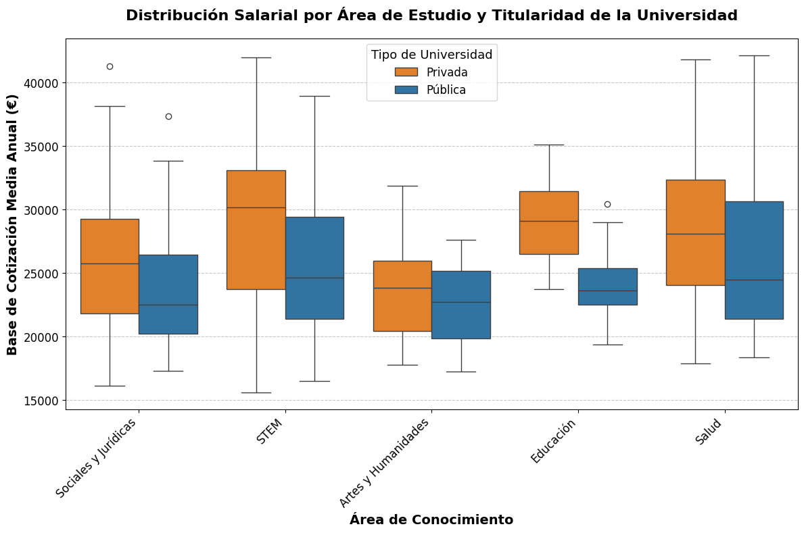

# 📊 Análisis Econométrico de la Dispersión Salarial

Análisis empírico sobre microdatos del mercado de trabajo para evaluar la influencia de variables académicas, institucionales y sociodemográficas en los retornos salariales, desarrollado íntegramente en Python.

---

## 🎯 Objetivo y Enfoque de Investigación
Evaluar los determinantes del salario y la dispersión salarial inicial analizando el impacto del tipo de estudios y variables sociodemográficas mediante especificaciones de regresión lineal múltiple con términos de interacción.

---

## 🛠️ Tecnologías y Librerías
* **Lenguaje:** Python 3.12
* **Procesamiento de datos:** Pandas, NumPy
* **Modelización econométrica:** Statsmodels, SciPy
* **Visualización:** Matplotlib, Seaborn

---

## 📈 Análisis Exploratorio y Resultados Visuales

### 1. Dispersión Salarial según Universidad y Titulación
Evaluación de las diferencias salariales y dispersión observada entre egresados en función de la institución y el ámbito de estudio.



### 2. Distribución Salarial y Ajuste de Densidades
Contraste de asimetría y normalidad sobre la distribución de bases de cotización / salario bruto.


### 3. Diagnóstico de Multicolinealidad
Matriz de correlación para prevenir problemas de colinealidad antes de la estimación del modelo de regresión multivariante (MCO).


---

## 📐 Metodología Econométrica y Diagnósticos
* **Modelo principal:** Regresión lineal multivariante (MCO / OLS) incorporando efectos fijos y términos de interacción.
* **Diagnósticos del modelo:**
  * Contraste de heterocedasticidad (Breusch-Pagan / White) con cálculo de errores estándar robustos.
  * Análisis del factor de inflación de la varianza (VIF).

---

## 🚀 Cómo Reproducir el Proyecto

1. Clonar el repositorio:
   ```bash
   git clone [https://github.com/Alexggarcia7/wage-dispersion-analysis.git](https://github.com/Alexggarcia7/wage-dispersion-analysis.git)
